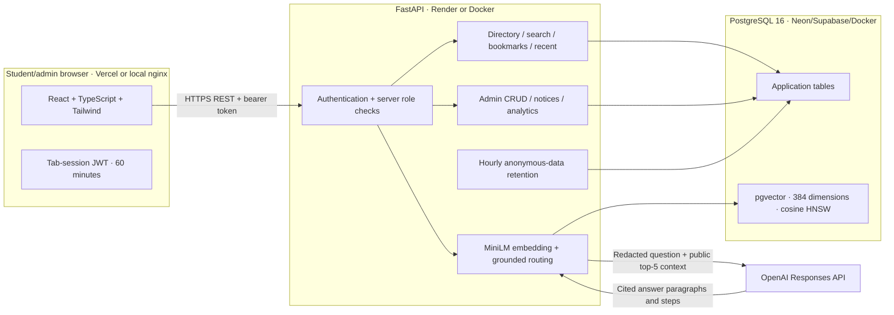
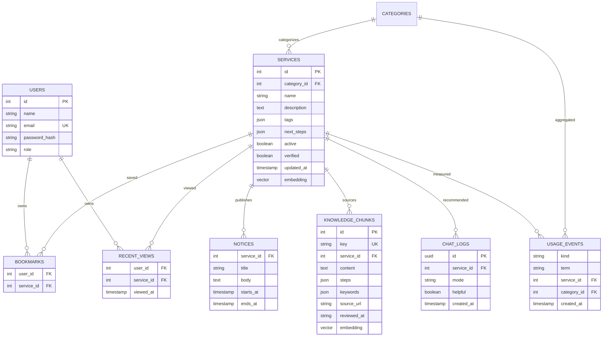

# Architecture and design

## 1. System architecture



Deployment boundaries matter: keys stay on the API; frontend environment contains only its public API URL. Public registration always creates students. Both admin navigation and backend authorization enforce roles, with the backend being authoritative. No UTA SSO, MyMav, payment, official record or live scraping integration exists.

## 2. Domain/database model



Bookmark/recent uniqueness is database-enforced per user/service. Recent history is pruned to ten records when a detail is opened. Chat/usage events have no account link; no question text is stored. Notice dates are validated and applied in queries. Services are archived, not physically deleted, to preserve referenced data. Category deletion is denied while referenced.

## 3. Recommendation sequence

```mermaid
sequenceDiagram
  participant S as Student UI
  participant A as API
  participant M as MiniLM (local)
  participant D as PostgreSQL/pgvector
  participant L as Hosted model
  S->>A: POST /api/chat (question + bearer token)
  A->>A: Verify session; redact known name/email/numeric identifiers
  A->>M: Encode question (normalized 384-D)
  A->>D: Hybrid BM25/vector passage retrieval for active services
  D-->>A: Passages, trusted citation URLs and source IDs
  alt below confidence threshold / no candidates
    A-->>S: Clarifying question
  else confident retrieval
    A->>L: Redacted question + public candidate records, store=false
    L-->>A: Generated paragraphs and steps with source IDs
    A->>A: Validate source citations and reject arbitrary URLs
    A-->>S: Contextual explanation, steps, source citations and related office
  else hosted timeout / malformed / unknown ID
    A->>D: Retrieved source summaries
    A-->>S: Explicitly labeled source-based fallback answer
  end
  A->>D: Anonymous answer UUID/mode/service, no question/account
  S->>A: Helpful/not-helpful rating for answer UUID
```

Lightweight keyword mode uses BM25 passage retrieval; hosted generation runs when a key/model are configured. Without them it returns cited source summaries. PostgreSQL RAG uses HNSW-indexed vector ranking. SQLite's optional semantic path scans embeddings and exists only for local debugging, not production performance claims.

## Decisions and limits

* The model writes an explanation and actions from retrieved passages and must cite each part. Source IDs/URLs are validated; model factual accuracy still requires evaluation. No model means curated source summaries, clearly labeled. See RAG.md for the knowledge table and import workflow.
* The API uses a single process and an in-memory IP rate limiter. If the project scales across replicas, replace it with a shared limiter and tune authenticated quotas. Private load tests can disable it to measure service processing separately, but that result must be labeled.
* Python dependencies use bounded ranges; frontend has a lockfile. Review/audit dependencies when deploying. Initial migration creates the fresh schema; future migrations must be reviewed as separate revisions.
* Semantic/model/provider latency, deployment cold starts, data freshness and human usability remain empirical checks. The diagrams describe this source package; they do not establish a team's historical progress.
